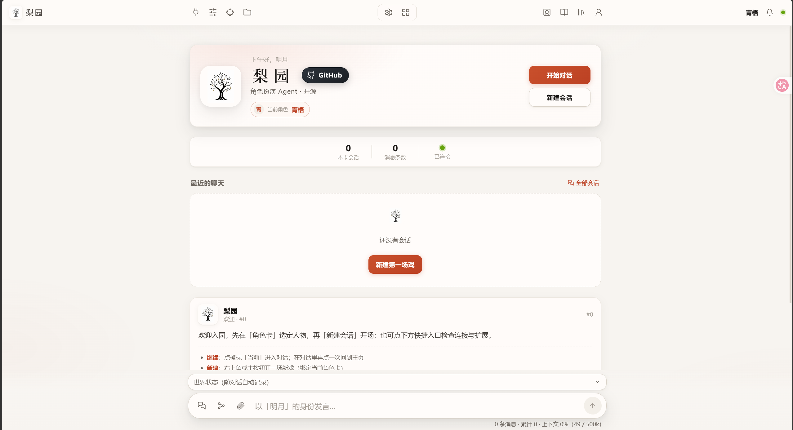

**English** · [简体中文](README_zh.md)

# Liyuan (梨园)

**An RP Agent built on pi, bringing coding agent superpowers to role-playing.**

📖 **[Documentation](https://docs.liyuan.pro)** · 🚀 **[Releases](https://github.com/weidu12123/Liyuan/releases)** · 🌐 **[Website](https://docs.liyuan.pro)**



---

## What is Liyuan?

**Liyuan** (梨园) is a next-generation Role-Play Agent built on top of [pi](https://github.com/earendil-works/pi). By reimagining coding agent primitives for creative storytelling and roleplay, Liyuan tackles the chronic limitations of traditional RP frontends—such as context bloat, setting drift, ungrounded hallucination, prompt clutter, and vendor lock-in—delivering an immersive, transparent, and deterministic role-playing experience.

---

## The RP Paradigm: Coding Agent Primitives Reimagined

Liyuan's core architecture translates proven software engineering agent paradigms directly into roleplay mechanics:

| Coding Agent Primitive | Liyuan RP Equivalent | Description |
|---|---|---|
| **Workspace / cwd** | **Isolated Card Space** | One directory per character card, isolating assets, sessions, memory, and state |
| **Code** | **Story Prose** | The narrative text treated as living creative output |
| **Edit / Patch** | **In-Place Targeted Revisions** | Surgical prose edits and adjustments without regenerating entire paragraphs |
| **Grep / Search** | **Text & Lore Retrieval** | On-demand search across lorebooks and past chapters without bloating context |
| **Rewind / Checkpoint** | **Branch Rollback & Revision** | Non-destructive story branching and checkpoint restore for alternate storylines |
| **Context Compaction** | **Narrative Compaction (Story Recap)** | Summarizing past chapters into faithful story recaps while keeping recent prose pristine |
| **Cross-Session Memory** | **Card-Level Memory & Forgetting** | Per-card consolidation across sessions with synchronized physical forgetting |
| **Permission Gate** | **Narrative Fork Decision Cards** | Interactive decision prompts (`ask` tool) at crucial plot junctures for user choice |
| **SYSTEM.md / AGENTS.md** | **Engine Protocols & World Laws** | Fully transparent, file-based prompt layers with modular toggles |

---

## Key Capabilities

### 1. Advanced Memory Architecture
- **Pristine Context & Narrative Compaction**: The harness deterministically filters intermediate thought processes and noise, compiling lengthy dialogues into coherent story recaps.
- **Real-Time State Ledger & Cast Roster**: A sidecar ledger automatically tracks in-universe time, locations, items, and character presence to prevent setting drift across turns.
- **On-Demand Lorebook Retrieval**: Worldbooks and knowledge bases remain outside the active prompt window until the model explicitly queries them, keeping the context window light and focused.
- **Card-Level Cross-Session Memory & Physical Forgetting**: Session debriefs automatically merge into persistent card memory; deleting a conversation physically triggers true forgetting of associated facts.


### 2. High Customizability & Co-Creation
- **Layered Prompt Architecture**: Exposes `SYSTEM.md` (engine protocol) and `AGENTS.md` (world rules and character lore) for transparent, file-level editing with entry-by-entry toggles.
- **Collaborative Card Workshop & Sandbox**: Built-in card studio allows users and the Agent to co-author, debug, and preview character cards and custom front-end scripts in a secure sandbox.


### 3. Portability & Zero Vendor Lock-In
- **Physically Portable Card Spaces**: Each card is an independent workspace containing its own sessions, state, and memory. Simply copy the card folder across machines and pick up right where you left off.
- **Universal Format Support**: Full interoperability with standard Tavern / Character Card V2 & V3 formats, lorebooks, and chat histories without platform restrictions.
- **Transparent Local File Storage**: All data is saved as plain text JSON and Markdown. Zero black-box databases—effortless backup, versioning, and inspection.

### 4. Deep User Immersion
- **Interactive Plot Junctions**: At pivotal narrative moments, the Agent uses the `ask` tool to present branching choices and free-form inputs, co-authoring the story with you.
- **Intent-Driven Prose Editing**: Request subtle adjustments or line replacements directly, eliminating the need to discard and regenerate entire paragraphs.

---

## Quick Start

> For complete visual guides and interface walkthroughs, see the **[Liyuan Documentation (docs.liyuan.pro)](https://docs.liyuan.pro)**.

### Requirements
- **Node.js ≥ 22**
- Any OpenAI-compatible API key (e.g., DeepSeek, OpenAI, Claude via proxy, etc.)

### Running Locally

```bash
# Copy example configuration files
cp liyuan.agent.example.json liyuan.agent.json
cp liyuan.config.example.json liyuan.config.json

# Edit liyuan.agent.json to set your apiKey, baseURL, and model ID

# Install dependencies and start
npm install
npm run web:build    # Build frontend (can be skipped if web/dist already exists)
npm run web          # Launch server
```

- **Windows**: Double-click `start.bat`
- **Linux / macOS**: Run `chmod +x start.sh && ./start.sh`
- Open `http://127.0.0.1:7620` in your browser.

> **Security Note**: Port 7620 does not enforce authentication by default. Do not expose it directly to the public internet without a reverse proxy and authentication layer.

---

## Deployment

### Docker Compose

```bash
git clone --depth 1 https://github.com/weidu12123/Liyuan.git && cd Liyuan
docker compose up -d --build
```
Data and configurations persist in local mapped volumes.

You can also use prebuilt multi-arch images directly from GHCR without building from source:

```bash
mkdir -p liyuan && cd liyuan
curl -fsSL -o docker-compose.yml https://raw.githubusercontent.com/weidu12123/Liyuan/master/deploy/compose.ghcr.yml
docker compose up -d
```

---

## Architecture & Development

```
Domain Layer    src/                        Character cards, lorebooks, staging, memory, timelines
Wiring Layer    .liyuan/extensions/roleplay.ts   pi extension hooks and tool registrations
Web Layer       server/ + web/             Backend orchestration, WebSocket/REST protocols, and Web UI
Core Layer      packages/@liyuan/*         Locally maintained pi agent core framework
```

Running unit tests:
```bash
node --test test/*.test.ts
```

---

## License

- The main project is licensed under the **[PolyForm Noncommercial 1.0.0](LICENSE)** license: Free for personal and non-commercial use, modification, and distribution. Any commercial use requires prior authorization from the author.
- Core agent modules are derived from [pi](https://github.com/earendil-works/pi) (MIT License), maintaining all original copyright notices.

---

## Community & Links

- **Documentation**: [docs.liyuan.pro](https://docs.liyuan.pro)
- **Community Forum**: [linux.do](https://linux.do)
